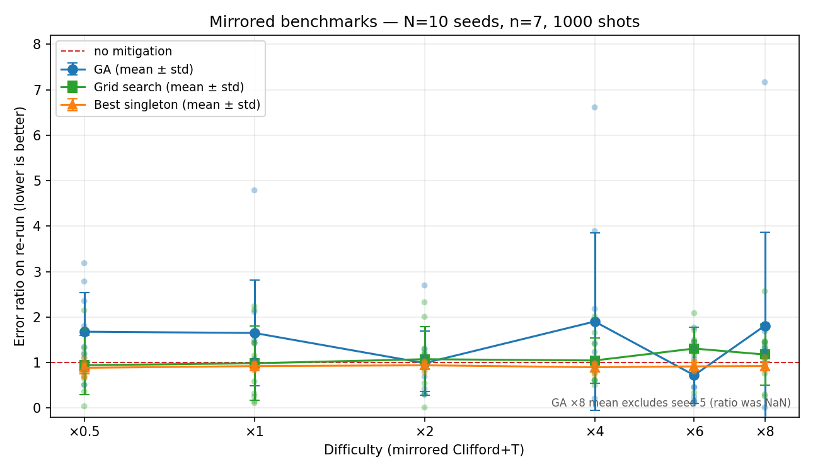
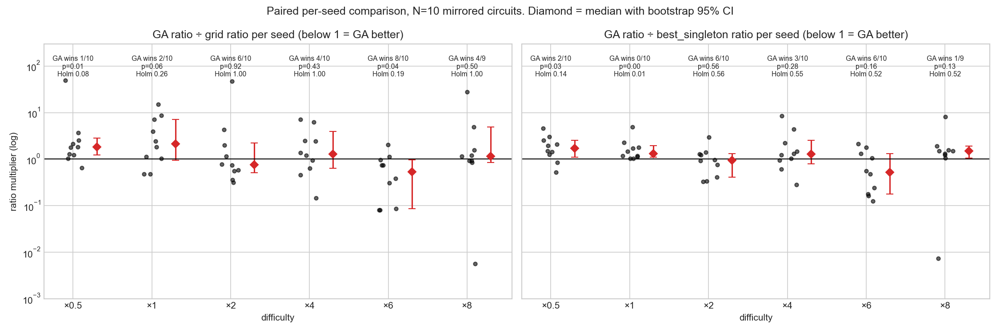
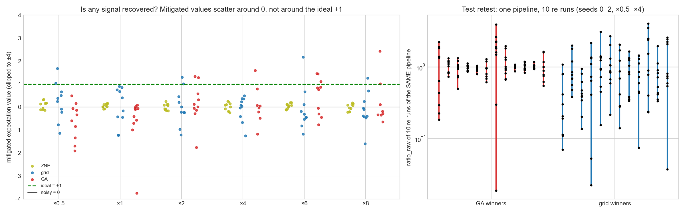
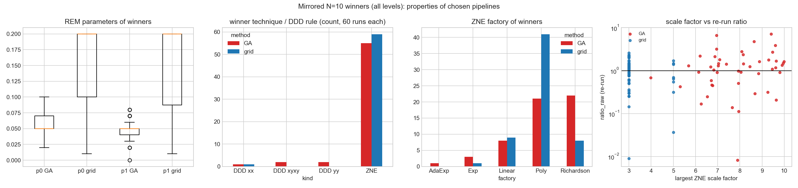
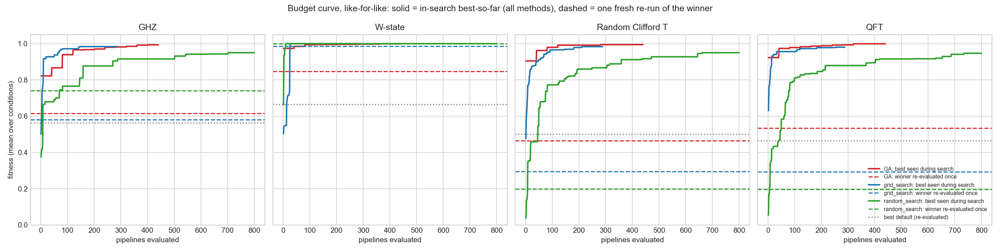
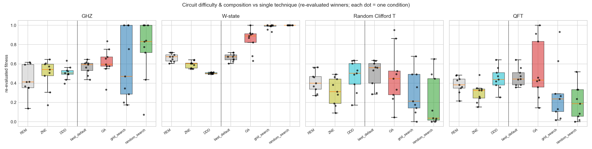

# Mirrored Clifford+T experiments and analysis (Marco)

- **Data for your own analysis:** [`data/`](data/). Tidy CSVs with a data dictionary: one row per seed × multiplier × method, plus GA curves and re-run data.
- **Results/Discussion first draft:** [`RESULTS_DRAFT.md`](RESULTS_DRAFT.md), with paper figures in [`paper_figures/`](paper_figures/) (PDF + PNG, regenerated from `data/` by `make_results_figures.py`).

Self-contained: `dna-game-2.py` here is the exact version that produced these results (pre-`src/gene` refactor, plus best-ever chromosome tracking and `DNA_MAX_WORKERS`). Run everything from this folder, e.g. `python analysis_20260923.py` (pandas/scipy/sklearn only, ~6 s; output in `results/20260923_analysis/run_log.txt`). Long-form notes: [`WRITEUP.md`](WRITEUP.md).

## Setup (answers "is the mirror literally U†? what do multipliers scale?")

Each circuit is a random Clifford+T circuit C on n = 7 qubits with round(k·n²) gates of each type (1q Cliffords, 2q Cliffords, T), followed by `cirq.inverse(C)` = C† (every gate inverted, reverse order), so ideal ⟨Z⊗7⟩ = +1 exactly. The multiplier k ∈ {0.5, 1, 2, 4, 6, 8} scales **circuit size, not noise strength**: 24/49/98/196/294/392 gates per type, i.e. 144–2,352 gates in the mirrored circuit. Noise is fixed (depolarizing 0.01 per qubit per moment + bit-flip, phase-flip, amplitude damping 0.05 at the end; 1,000 shots). The seed fixes the circuit; the same seed gives the same circuit to every method, so comparisons are paired. Suggest calling k a "depth multiplier", not a "noise level".

Score: `ratio_raw` = |mitigated − ideal| / |noisy − ideal| from one fresh re-run of the chosen pipeline (lower is better, 1 = no gain).

## Results (N = 10 seeds, all multipliers, all methods)

Median `ratio_raw` (n):

| k | GA | grid | REM | ZNE | DDD |
|---|---|---|---|---|---|
| ×0.5 | 1.49 (10) | 0.74 (10) | 0.99 (10) | 0.90 (10) | 1.02 (10) |
| ×1 | 1.25 (10) | 0.87 (10) | 0.97 (10) | 0.96 (10) | 1.01 (10) |
| ×2 | 0.94 (10) | 1.09 (10) | 1.01 (10) | 0.99 (10) | 1.00 (10) |
| ×4 | 1.14 (10) | 0.91 (10) | 0.99 (10) | 0.98 (10) | 1.01 (10) |
| ×6 | 0.46 (10) | 1.36 (10) | 1.01 (10) | 0.95 (10) | 1.02 (10) |
| ×8 | 1.30 (9) | 1.23 (10) | 0.98 (10) | 0.97 (10) | 1.01 (10) |

Raw data: GA `results/20260613_multi_seed` (seeds 0–2), `results/20260706_ga_expand` (3–9), `results/20260726_x6_x8`; grid + singletons `results/20260623_expand_seeds`, `results/20260726_x6_x8`; paper CSVs/figures `results/20260913_mirrored_paper`. ×8 seed 5 GA is missing (NaN). **10 seeds, not the 20 targeted** — see cost note below.

## Statistical tests (`results/20260923_analysis/mirrored_*.csv`)

Paired by seed on log `ratio_raw`: Wilcoxon signed-rank, sign test, exact sign-flip permutation, bootstrap 95% CI, Holm correction across the 6 multipliers. Wilcoxon rather than Mann-Whitney because seeds pair the methods (same circuit), which removes circuit-to-circuit variance; Mann-Whitney is used for between-multiplier comparisons, where groups are independent.

| GA vs grid | ×0.5 | ×1 | ×2 | ×4 | ×6 | ×8 |
|---|---|---|---|---|---|---|
| GA wins | 1/10 | 2/10 | 6/10 | 4/10 | 8/10 | 4/9 |
| median GA/grid multiplier | 1.81 | 2.11 | 0.76 | 1.28 | 0.53 | 1.15 |
| Wilcoxon p | 0.014 | 0.064 | 0.92 | 0.43 | 0.037 | 0.50 |
| Holm-adjusted p | 0.08 | 0.26 | 1.00 | 1.00 | 0.19 | 1.00 |

Between multipliers (d = log GA − log grid): ×4 vs ×6 p = 0.038, ×6 vs ×8 p = 0.066, Kruskal-Wallis across all six p = 0.032.

**Is ×6 chance? Most likely yes.**
- It is not significant after correcting for six multipliers (Holm p = 0.19). At ×0.5 the GA is significantly *worse*, and over all levels the GA wins 25 of 59 seeds.
- There is no signal to recover. The noisy value is 0.00 ± 0.03 at every multiplier, and mitigated values scatter around 0, not +1. The GA's ratio < 1 on 6/10 seeds at ×6 matches a coin flip (binomial p = 0.75).
- Test-retest: re-running the *same* winning pipeline 10× (`results/20260617_multisample`) gives intraclass correlation −0.08 (GA) and 0.07 (grid). Pipeline identity explains essentially none of the score variance; one GA pipeline scored 0.18, then 1.92, 1.85, 2.23. Measured at ×0.5–×4 only. The direct ×6 check would be re-running the 20 saved ×6 winners ~10× each (cheap, no new search).

## RQ2 examples (GA works vs fails)

The best and worst GA runs are the same kind of pipeline, Richardson ZNE with scale factors ~4–9, so luck rather than skill: ×8 seed 2 `Richardson[3.9, 5.1, 7.9], fold_all` → 0.008; ×8 seed 3 `Richardson[5.6, 8.8, 9.4], fold_gates_at_random` → 7.17. Full lists are in `run_log.txt`.

## RQ3 parameter analysis (`figB3`, `mirrored_winners_parsed.csv`)

- Winning technique: REM+ZNE in 55/60 GA and 59/60 grid runs. DDD winners: GA xx 1, xyxy 2, yy 2; grid xx 1.
- REM: GA winners p0 median 0.05 (IQR 0.05–0.07), p1 0.05 (0.04–0.05); grid winners mostly 0.2/0.2 (edge of its grid).
- Larger ZNE scale factors make the output swing more (Spearman 0.25, p = 0.008) but not better (0.09, p = 0.34).

## RQ4 logistic regression (standardized coefficients in `logreg_*.csv`)

- May data, all 55k evaluations, y = fitness > 0.5: held-out-circuit AUC 0.72, mostly from circuit type. Within pipeline parameters, only REM p0/p1 matter: moving away from ~0.05 hurts (−0.59 / −0.38). DDD rule and fold method are ~0.
- Mirrored winners, y = ratio_raw < 1: AUC 0.52, i.e. chance. Parameters don't predict re-run success, so GBM + SHAP would have nothing to explain.

## M6: DDD under our noise model — DDD is an exact no-op

`check_ddd_noop.py` (needs mitiq) uses an exact density-matrix simulation of `execute()`'s noise. Inserting XX, YY or XYXY leaves ⟨Z…Z⟩ unchanged to 10 decimals, on a toy circuit and on a mirrored circuit. Idle qubits **do** get noise: `with_noise(depolarize)` adds a depolarizing channel to every qubit in every moment, so the noise is per moment, not per gate. DDD still can't help, because depolarizing noise commutes with every unitary, so an X·X sequence just cancels; the end-of-circuit channels come after all gates. So REM+DDD ≡ REM + shot noise. Treat DDD as a negative control. This affects the May result too: 14/18 GA winners on RCT/QFT were REM+DDD.

## M3: where GA winners land relative to grid's space

- REM: 59/60 GA winners lie inside grid's range [0.01, 0.2]. The GA's REM mutation is ±0.01 from 0.05; the [0, 1] range applies to random search only.
- ZNE: 48/55 GA winners use a factory grid never tries, and 46/55 have scale factors above grid's max of 5 (median 7.5).
- So the confound is real for ZNE only. Suggest the threats-to-validity caveat (option b).

## GA implementation notes (affect interpretation)

- The ZNE "perturb scale factors" mutation is dead code: it assigns `factory.scale_factors`, but mitiq reads `_scale_factors` (verified). ZNE mutation is therefore 1/3 change fold, 1/3 brand-new random factory, 1/3 nothing, so effectively random search for ZNE.
- No elitism: every individual is mutated before reuse. `repop` clones the top half, so ~28 of 40 are unique per generation and the lucky copy wins.
- One crossover swap per generation.
- Fitness is a single noisy evaluation, and the max over ~840 draws gives the winner's curse, which favours high-variance pipelines.

## May (0513) graphs regenerated (`figA1`, `figA2`, `may_stats.csv`)

The 0513 budget curve compared GA's in-search best against grid/random's one-shot re-evaluation. Like-for-like, all three reach ~0.95–1.0 in search. On re-evaluation the GA is still ahead on RCT/QFT: 0.50 vs grid 0.29 (13/18, p = 0.054) and random 0.20 (15/18, p < 0.001), and level with the best single technique (0.48). Caveat: the May circuit seed was fixed at 0, so seeds 0–2 are repeats of the same circuit (12 distinct circuits; GA vs grid p = 0.34 after averaging seeds).

## Sample size

The results stay at N = 10 seeds per multiplier; no new runs are planned. Extending to 20 would cost ≈ 130 h of compute at ×0.5–×4 and ≈ 530 h at ×6/×8. Given test-retest ICC ≈ 0, extra seeds would measure the noise more precisely rather than change the conclusion.
