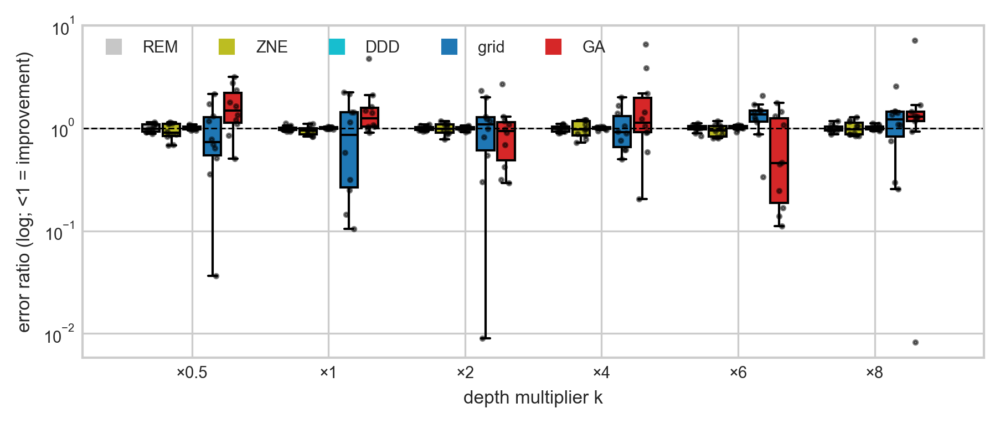
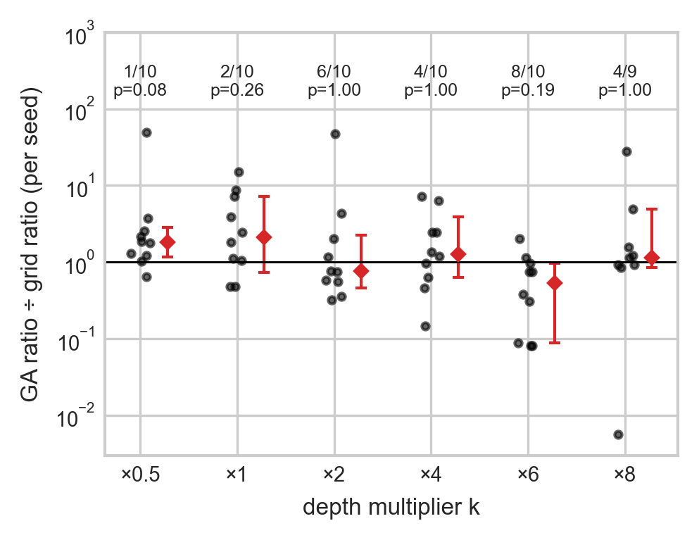
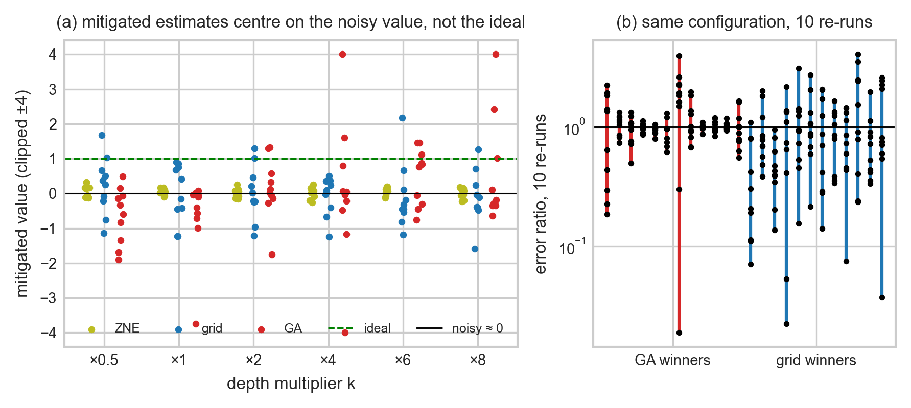
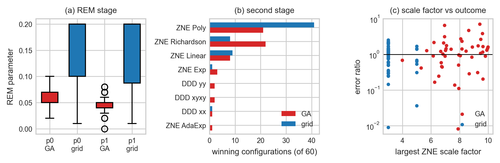

# Results and Discussion — first draft (agent-generated from `data/`)

Every number here is reproducible from `data/mirrored_runs.csv`, `data/mirrored_retest.csv`, `analysis_20260923.py` and `make_results_figures.py`. Figures are in `paper_figures/` (PDF + PNG). Terminology follows the proposed glossary: *technique* (REM/ZNE/DDD), *stage* (one parameterized technique), *pipeline* (ordered stages), *configuration* (pipeline + parameter values). Section numbers are placeholders.

## Narrative in one paragraph (for aligning Intro/Abstract)

Search over composed QEM pipelines finds configurations that look excellent *during search*: the best in-search error ratios are ~0.04–0.07. On a fresh evaluation, however, they return to ~1.1, i.e. no better than doing nothing. On the non-mirrored benchmarks (GHZ, W-state, Random Clifford+T, QFT), where the noisy circuit still carries signal, the GA's chosen configuration beats grid and random search on the harder circuits on re-evaluation, but only ties the best single default technique. On the mirrored Clifford+T benchmark, the noisy expectation value is ≈ 0 at every depth, so there is no signal left to mitigate. There, no method reliably improves on doing nothing, apparent wins (such as GA at ×6) do not survive correction for multiple comparisons, and the same configuration re-run gives scores that are essentially uncorrelated with its first run. What *does* characterize effective configurations is consistent across benchmarks: REM parameters near the true readout error (~0.05), moderate ZNE extrapolation, and DDD contributing nothing under our noise model. The broader message for search-based QEM is that the fitness signal, not the search algorithm, is the bottleneck: with single-shot evaluations, any optimizer mostly selects for lucky noise.

## 5.1 Evaluation protocol (recap)

- **Benchmarks.** (i) Non-mirrored circuits at 5–7 qubits: GHZ, W-state, Random Clifford+T, QFT. (ii) Mirrored Clifford+T on 7 qubits: C·C† at depth multipliers k ∈ {0.5, 1, 2, 4, 6, 8}, i.e. 144–2,352 gates, with ideal ⟨Z⊗7⟩ = +1.
- **Noise.** Fixed across all runs (see Noise Model).
- **Methods.** GA (population 40, 20 generations, 840 evaluations), grid search (288 configurations), random search (800, non-mirrored only) and three single default techniques (REM, ZNE, DDD).
- **Pipelines.** All searched pipelines are REM+DDD or REM+ZNE.
- **Metric.** The error ratio |mitigated − ideal| / |noisy − ideal| from **one fresh re-run** of each method's chosen configuration. In-search fitness is reported only to quantify selection bias.
- **Statistics.** On mirrored circuits each seed defines one circuit shared by all methods, so comparisons are **paired**. We use the Wilcoxon signed-rank test on log error ratios, an exact sign-flip permutation test, a sign test and bootstrap 95% CIs, with Holm correction across the six multipliers. Between-multiplier comparisons use Mann-Whitney U and Kruskal-Wallis. N = 10 seeds per multiplier; GA ×8 seed 5 is missing.

## 5.2 RQ1: Does search find better pipelines than the baselines?

**Non-mirrored benchmarks (Fig. A1, A2).** Measured like-for-like (best configuration seen so far during search), GA, grid and random search all reach in-search fitness ≈ 0.95–1.0 within their budgets (Fig. A1, solid lines). On re-evaluation (dashed lines) the picture separates by circuit:

| | GA | grid | random | best single technique |
|---|---|---|---|---|
| RCT + QFT, mean re-evaluated fitness | 0.50 | 0.29 | 0.20 | 0.48 |
| GA wins (of 18 runs) | — | 13 (p = 0.054) | 15 (p < 0.001) | 10 (p = 0.73) |

- On W-state the GA is *worse* than grid/random (0.85 vs 0.99/1.00, p = 0.008), a ceiling effect.
- These runs used a single circuit per (circuit type, size); averaging repeat seeds leaves 12 distinct circuits, and GA vs grid becomes p = 0.34.

> Earlier internal plots compared the GA's in-search maximum with grid/random's re-evaluated score, which overstated the GA's advantage. Fig. A1 corrects this.

**Mirrored Clifford+T (Fig. R1, R2).** No method consistently beats doing nothing (Fig. R1). Median error ratios of the single techniques stay within 0.90–1.02 at every multiplier. The searched methods spread far wider in both directions (GA 0.46–1.49, grid 0.74–1.36 by multiplier median). Paired GA-vs-grid comparisons (Fig. R2) show no consistent winner:

| k | ×0.5 | ×1 | ×2 | ×4 | ×6 | ×8 |
|---|---|---|---|---|---|---|
| GA better (seeds) | 1/10 | 2/10 | 6/10 | 4/10 | 8/10 | 4/9 |
| median GA/grid ratio | 1.81 | 2.11 | 0.76 | 1.28 | 0.53 | 1.15 |
| Wilcoxon p (raw) | 0.014 | 0.064 | 0.92 | 0.43 | 0.037 | 0.50 |
| Holm-adjusted p | 0.08 | 0.26 | 1.00 | 1.00 | 0.19 | 1.00 |

Overall the GA beats grid on 25 of 59 paired runs. The ×6 advantage (8/10, median ratio 0.53, bootstrap CI 0.09–0.97) is nominally significant on its own, but not after correction, and the sign flips at ×8 (4/9) and at ×0.5, where the GA is worse (1/10). The between-multiplier tests do detect heterogeneity (Kruskal-Wallis p = 0.032; ×4 vs ×6 p = 0.038), but ×6 was singled out after seeing the data and is not reproduced at neighbouring depths. We therefore do not claim a depth regime in which the GA outperforms grid search.

## 5.3 How reliable is a single evaluation? (Fig. R3)

Three observations explain why the mirrored results are inconclusive.

1. **No signal to recover.** The noisy value is 0.00 ± 0.03 at every multiplier, including ×0.5: the mirrored circuits are fully decohered under our noise model. Mitigated estimates scatter around 0 rather than around the ideal +1 (Fig. R3a). For the GA, the share of runs with error ratio < 1 (37%) is what a coin flip would give (e.g. ×6: 6/10, binomial p = 0.75).
2. **Selection inflates in-search scores ~10–30×.** The median best in-search fitness corresponds to error ratios of 0.068 (GA) and 0.036 (grid). Re-running the same configurations gives 1.17 and 1.12. Taking the maximum over hundreds of noisy evaluations (the winner's curse) selects lucky draws. Consistent with this, re-running the GA's best-ever configuration was no better, and nominally 1.3× worse, than its last generation's best (48 runs, p = 0.15).
3. **Scores do not repeat.** Re-running the same winning configuration 10 times (Fig. R3b) gives an intraclass correlation of −0.08 for GA winners and 0.07 for grid winners. Which configuration was chosen explains essentially none of the variance in its score. One GA configuration scored 0.18, then 1.92, 1.85 and 2.23.

## 5.4 RQ2: When does the GA work and when does it fail?

The best and worst GA outcomes come from the same kind of configuration: REM+ZNE with Richardson extrapolation from large scale factors.

| run | configuration | error ratio |
|---|---|---|
| ×8, seed 2 (best) | REM(0.06, 0.05) + ZNE Richardson [3.9, 5.1, 7.9], fold_all | 0.008 |
| ×6, seed 1 | REM(0.05, 0.06) + ZNE Exp [6.9, 7.9], fold_all | 0.11 |
| ×6, seed 6 | REM(0.04, 0.05) + ZNE Richardson [5.1, 6.4, 9.3], fold_all | 1.77 |
| ×8, seed 3 (worst) | REM(0.04, 0.06) + ZNE Richardson [5.6, 8.8, 9.4], fold_gates_at_random | 7.17 |

Extrapolating to zero noise from scale factors of 4–9 amplifies shot noise. These configurations produce widely spread estimates, and the GA, which keeps the best of many noisy draws, preferentially selects them. On the non-mirrored circuits, where signal remains, the GA's successful configurations are mostly REM(≈0.05, ≈0.05)+DDD (14 of 18 winners on RCT/QFT), which in our noise model is equivalent to REM alone (§5.5).

## 5.5 RQ3: What characterizes effective configurations? (Fig. R4)

- **REM stage.** GA winners concentrate at p0 = 0.05 (IQR 0.05–0.07) and p1 = 0.05 (0.04–0.05), matching the simulated readout error. Grid winners sit mostly at 0.2/0.2, the edge of its grid. Across all 55k evaluations on the non-mirrored benchmarks, moving p0/p1 away from ≈0.05 is the strongest pipeline-level predictor of a poor score (§5.6).
- **Second stage.** On mirrored circuits nearly all winners are REM+ZNE (GA 55/60, grid 59/60). Grid favours polynomial extrapolation at scale factors [1, 1.5, 2, 2.5, 3]; the GA favours Richardson and polynomial with scale factors up to ~10. DDD rules appear rarely (GA: xx 1, xyxy 2, yy 2; grid: xx 1).
- **ZNE scale.** Larger maximum scale factors make the estimate swing more (Spearman ρ = 0.25 with |mitigated|, p = 0.008) but are not associated with better outcomes (ρ = 0.09 with error ratio, p = 0.34).
- **DDD contributes nothing under our noise model.** Exact density-matrix simulation shows that inserting XX, YY or XYXY sequences leaves ⟨Z…Z⟩ unchanged to 10 decimal places. Idle qubits *are* subject to depolarizing noise, but depolarizing noise commutes with every unitary, so a DD sequence that composes to the identity cancels exactly. The readout channels act after all gates. REM+DDD is therefore REM plus shot noise, a built-in negative control.

## 5.6 RQ4: Can pipeline parameters predict performance?

We fit L2-regularized logistic regression on standardized features: stage type, REM p0/p1, DDD rule, ZNE factory, folding method, scale-factor count/min/max, plus circuit covariates.

- **Non-mirrored, all 55,008 evaluations** (outcome: fitness > 0.5, i.e. error ratio < 1). Held-out-circuit AUC is 0.72 ± 0.09, mostly from circuit type (W-state +0.71; RCT, QFT ≈ −0.70). Among pipeline parameters, only REM matters (p1 −0.59, p0 −0.38). DDD rule and folding method have coefficients ≈ 0.
- **Mirrored winners** (n = 119; outcome: re-run error ratio < 1). Cross-validated AUC is 0.52 ± 0.08, chance level. Pipeline parameters do not predict whether a chosen configuration succeeds on re-evaluation.

A gradient-boosted model with SHAP was not pursued: at chance-level predictability there is no structure for it to explain.

## 6 Discussion

**Why search struggles here.** The GA and grid search optimize a fitness that is a single noisy evaluation. When the circuit still carries signal (GHZ, W-state, and to a lesser degree RCT/QFT), search finds sensible configurations. When it does not (all mirrored depths), the optimizer's maximum is dominated by noise, and more aggressive extrapolation simply provides more noise to select from. A larger search space (the GA's continuous ZNE parameters) increases this effect rather than helping. Under a fixed budget, the *output* space (the precision of one evaluation) is too small relative to the *input* space (the number of configurations).

**Implications.** Search-based QEM needs (i) repeated or averaged evaluations per configuration, or at least re-evaluation of the top candidates before selection, (ii) benchmarks whose noisy expectation value retains signal (e.g. noisy ⟨O⟩ ≈ 0.3–0.7), and (iii) noise models in which each technique's mechanism can act (e.g. coherent or low-frequency idle noise for DDD).

**GA implementation notes.** These are for transparency, and may belong in Methods.
- The ZNE scale-factor perturbation in our mutation operator has no effect, because mitiq stores scale factors internally. ZNE mutation therefore either changes the folding method or redraws the factory.
- There is no elitism.
- Truncation selection clones the top half, so ~30% of evaluations are repeats.

These limit fine-tuning but do not change the conclusion above, which is driven by evaluation noise.

### Threats to validity

- **Oracle fitness (M5).** All methods optimize against the known ideal value, standard for QEM benchmarks. We did not test transfer to held-out circuits; given the test-retest results, transfer cannot be expected to exceed same-circuit repeatability.
- **Noise model (M6).** Depolarizing noise per moment on every qubit, plus end-of-circuit readout channels. DDD is provably inert under this model, so conclusions about DDD do not transfer to hardware with coherent idle errors.
- **Search-space confound (M3).** The REM stage is comparable: 59/60 GA winners lie within grid's range [0.01, 0.2]. The ZNE stage is not: 48/55 GA winners use factories outside grid's five, and 46/55 use scale factors above grid's maximum of 5. GA-vs-grid differences in REM+ZNE may reflect search space rather than search strategy.
- **Unequal budgets.** GA 840 evaluations vs grid 288.
- **Re-evaluation rule.** For seeds 0–2 at ×0.5–×4, the GA's reported configuration was its last generation's best rather than the best-ever. On the 48 runs where both were logged, the difference is not significant (p = 0.15).
- **Sample size and seeds.** N = 10 per multiplier. On non-mirrored circuits the circuit seed was fixed, so repeat seeds are not independent circuits. A single seed controls both the GA's randomness and the simulator noise.
- **Simulation only.** 1,000 shots, one noise strength, no hardware validation.

### Future work

Longer pipelines (three or more stages); multiple noise models, including coherent and time-correlated idle noise; averaged or adaptive-shot fitness; train/test circuit splits for generalization; hardware validation.

## Figure list

| figure | file | source |
|---|---|---|
| A1 Budget curve, like-for-like (non-mirrored) | `results/20260923_analysis/figA1_budget_curve_fair.png` | `analysis_20260923.py` |
| A2 Re-evaluated fitness by circuit & method | `results/20260923_analysis/figA2_box_by_circuit.png` | `analysis_20260923.py` |
| R1 Error ratio by multiplier, all methods | `paper_figures/fig_results_ratio_by_multiplier.pdf` | `make_results_figures.py` |
| R2 Paired GA/grid per seed | `paper_figures/fig_results_paired_ga_grid.pdf` | `make_results_figures.py` |
| R3 Signal and test-retest | `paper_figures/fig_results_reliability.pdf` | `make_results_figures.py` |
| R4 Properties of winning configurations | `paper_figures/fig_results_properties.pdf` | `make_results_figures.py` |
